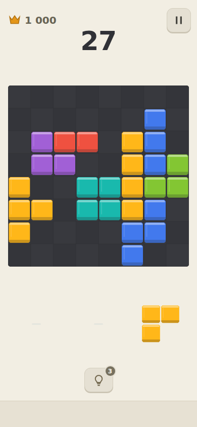
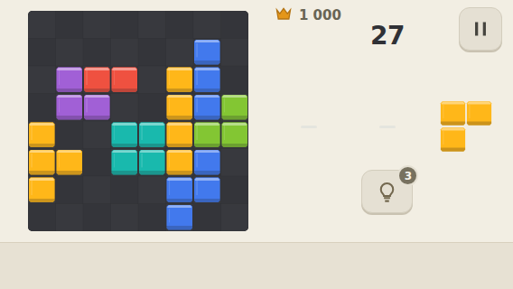

# Blocky Block Puzzle

Собственный блок-пазл Classic 8×8 для Android / RuStore.

Статус на 27.10.2026: preview 0.14 — новое светлое оформление, неглубокие пластиковые фишки, белый след очистки, награды у линии, плавный счёт и музыкальный добор. [Протокол и ограничения](docs/qa/FEEL_0.14_2026-10-27.md). Владелец проверил работоспособность 0.13 и отклонил её визуал; новый результат ещё ждёт плейтеста. Физические измерения и финальный звук остаются открытыми.

## Документы
- [Роудмапа и критерии готовности](docs/ROADMAP.md)
- [Уточнения к ТЗ и решения](docs/DECISIONS.md)
- [Исходное ТЗ v1](docs/BLOCK_PUZZLE_DEVELOPMENT_SPEC_V1_2026-10-23.md)
- [Исследование конкурентов и 39 отзывов](docs/research/BLOCK_PUZZLE_COMPETITOR_RESEARCH_2026-10-23.md)

Приоритет: явное актуальное решение владельца → DECISIONS → исходное ТЗ. ROADMAP определяет последовательность и проверку, не сокращает обязательный релизный scope. Исследование — обоснование и ограничения доказательств, а не контракт реализации.

Стек: TypeScript + Phaser + Vite + Capacitor; нативный Yandex Mobile Ads; HTML/CSS для меню, без отдельного React-слоя. Версии закреплены в package-lock.json.

Первый релиз: Classic, подсказки, комбо, выразительный звук/эффекты, обе ориентации, сохранение, три рекламных формата, аналитика. Adventure — отдельный этап после запуска в этом же приложении.

Исходные документы перенесены из предоставленных файлов от 23.10.2026 без редакторских изменений. У имени файла исследования снят суффикс « (1)», чтобы сохранить исходные относительные ссылки. Источники исследования заново не проверялись.

## Запуск и просмотр

```sh
npm ci
npm run dev
```

[Сборка и ограничения preview](docs/BUILD.md) · [Проверка game-kit](docs/KIT_REUSE.md) · [Предлагаемое оформление](docs/VISUAL_DIRECTION.md) · [QA-протокол 0.3](docs/qa/POLISH_0.3_2026-10-24.md)




