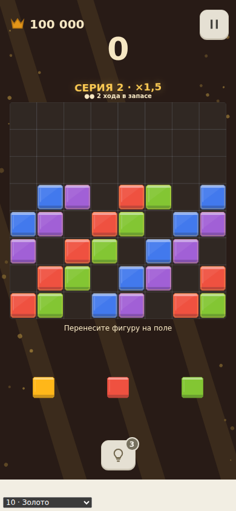
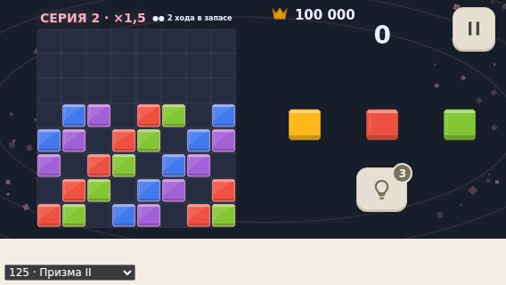

# Blocky Block Puzzle

Собственный блок-пазл Classic 8×8 для Android / RuStore.

Статус на 31.10.2026: preview 0.25 — оптимизация момента постановки: одна перестройка поля за кадр, переиспользование лотка, предварительный пул эффектов, запуск поиска похвалы через 180 мс. 86 unit + 90 browser и Android CI прошли. APK проверен; подпись совпадает с 0.24. [Протокол](docs/qa/PLACEMENT_0.25_2026-10-31.md). Повторный плейтест спайка на физическом Android остаётся открытым; реклама использует тестовые блоки.

Исследование пункта 7: [сравнение трёх политик выдачи, 9 000 игр](docs/qa/DEALER_COMPARISON_2026-10-27.md). Эксперимент `assist-v1` добавлен в ядро, текущая выдача по умолчанию сохранена.

Preview 0.16 собран и проверен в CI для сравнения выдачи: переключатель при новой партии, ускорение поиска без изменения результата. [Протокол проверок и серий](docs/qa/DEALER_0.16_2026-10-27.md).

Preview 0.17: рекламный контур Android, баннер в обеих ориентациях, rewarded-подсказки и второй шанс. Debug с тестовыми блоками; [проверки и ограничения](docs/qa/ADS_0.17_2026-10-28.md).

## Документы
- [Роудмапа и критерии готовности](docs/ROADMAP.md)
- [Уточнения к ТЗ и решения](docs/DECISIONS.md)
- [Исходное ТЗ v1](docs/BLOCK_PUZZLE_DEVELOPMENT_SPEC_V1_2026-10-23.md)
- [Исследование конкурентов и 39 отзывов](docs/research/BLOCK_PUZZLE_COMPETITOR_RESEARCH_2026-10-23.md)

Приоритет: явное актуальное решение владельца → DECISIONS → исходное ТЗ. ROADMAP определяет последовательность и проверку, не сокращает обязательный релизный scope. Исследование — обоснование и ограничения доказательств, а не контракт реализации.

Стек: TypeScript + Phaser + Vite + Capacitor; нативный Yandex Mobile Ads; HTML/CSS для меню, без отдельного React-слоя. Версии закреплены в package-lock.json.

Первый релиз: Classic, подсказки, комбо, выразительный звук/эффекты, обе ориентации, сохранение, три рекламных формата, аналитика. Adventure — отдельный этап после запуска в этом же приложении.

Исходные документы перенесены из предоставленных файлов от 23.10.2026 без редакторских изменений. У имени файла исследования снят суффикс « (1)», чтобы сохранить исходные относительные ссылки. Источники исследования заново не проверялись.

## Запуск и просмотр

```sh
npm ci
npm run dev
```

[Сборка и ограничения preview](docs/BUILD.md) · [Проверка game-kit](docs/KIT_REUSE.md) · [Предлагаемое оформление](docs/VISUAL_DIRECTION.md) · [QA-протокол 0.3](docs/qa/POLISH_0.3_2026-10-24.md)




