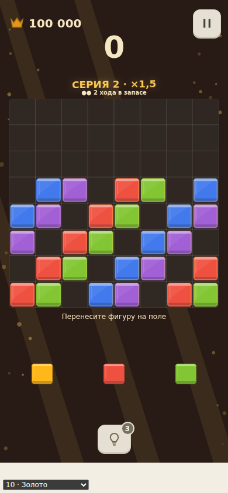
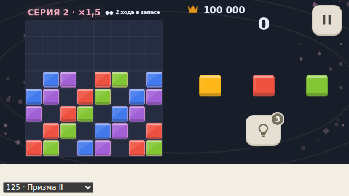

Preview0.63 /директор D73: подготовка→нагрузка→развязка, совместно решаемые тройки и задачи ради награды.96 партий/20889 ходов прошли замороженный пилот и независимую проверку,3519 маршрутов/601 ограничение подтверждены. Новая партия использует director-v2; старый resume сохраняет правила.278 unit,15 browser и build прошли; Android/APK ещё собираются. Человеческий баланс остаётся открытым. [Результаты и ограничения](docs/qa/DIRECTOR_GOAL_CYCLE_0.63_2026-11-10.md).

Директор D72: реализованы версия ядра/сохранений, задачи на порядок, крупная нагрузка и recovery.144 партии/23 617 ходов и256 новых стартов проверены. Нагрузка работает, но задач≈8%, полные очистки теряются;14 неразрешимых нагрузок раскрыты отдельно. Общая приёмка не пройдена, APK0.62/flow-v4 сохранены. [Код, результаты и точные дефекты](docs/qa/DIRECTOR_ORDER_LOAD_2026-11-10.md).

Директор D71: конструктивные две выдачи и перепланирование по реальному полю проверены в160 партиях. Ранние награды улучшились в агрегате, но общая приёмка не пройдена; отмена уже выполненной цели добавлена отдельно. [Результаты и следующий дефект](docs/qa/DIRECTOR_TWO_TRAY_2026-11-10.md).

Директор10.11: завершены два изолированных кандидата,820 человеческих ходов и160 бот-партий/23 255 ходов перепроверены. Защищённый архив и разнообразный старт не прошли gates; рабочая flow-v4 сохранена. [Причины, ограничения каталога и следующий этап](docs/qa/DIRECTOR_REWARD_FRONTIER_2026-11-10.md).

Preview0.62: полный праздник возвращён, готовые слои поля и два generated фона включены в обычной игре. Ошибка/таймаут картинки возвращает прежний renderer. В этой же APK — отдельное сравнение старого/нового перехода около100сек, без записи WebView и больших трасс. Физическая плавность ещё не принята. [Изменения и проверки](docs/qa/PREPARED_BACKGROUNDS_0.62_2026-11-10.md).

Изолированная проба готовых поверхностей: generated фоны и opacity-переход поля с полным праздником. На SwiftShader средний RAF20.934→18.379мс, длинные интервалы76→42 за4 измерения; max83.4мс остаётся. Это DEV-кандидат на двух темах, default0.61 и APK не меняются, физическая плавность не принята. [Протокол и запуск](docs/qa/PREPARED_SURFACES_2026-11-10.md).

Preview 0.61: сокращённый Classic включён по умолчанию — очистка до240мс, одна итоговая награда900мс, счёт сразу; без тряски, перелётов, fullscreen-салютов и ambient loop. Материалы/звук/вибрация сохранены. Полный стендовый цикл: средний RAF17.364→16.718мс, длинных интервалов7→2; отдельный max83.3мс остаётся, физическая плавность не принята. [Изменение и проверки](docs/qa/COMPACT_EFFECTS_0.61_2026-11-10.md). Проверены236 unit,215 browser, build/assets и подписанный APK с93 совпавшими production-файлами.

Phaser-прототип09.11 завершён: награды в существующем GL-контексте (Extern и штатный Mesh2D) и ограниченный GPU-фон поля ухудшили полный цикл на стенде. Проверены80 полных8-секундных эпизодов;231 unit/build/assets,4 browser и6 lifecycle прошли. Оптимизация не принята, APK не выпускалась. [Точные результаты](https://github.com/DanilaH/blocky-block-puzzle/blob/3262e87a604cdbc404f67ae4321ff994d8a62aa0/docs/qa/PHASER_FOREGROUND_2026-11-09.md).

Архитектурный прототип09.11: проверены перенос наград/текста темы в Canvas2D, их сочетание и отдельный WebGL renderer. Меньше слоёв не дало ускорения полного цикла; оба пути отклонены на стенде. 70 финальных8-секундных эпизодов,231 unit/build/assets,4 browser и4 lifecycle проверки. Код изолирован в spike, production/APK не менялись. Ручная смена настроек телефона снята с плана. [Результаты и воспроизведение](https://github.com/DanilaH/blocky-block-puzzle/blob/62736dd511ba5e9a5a561a1bb181dc35689e19d1/docs/qa/FOREGROUND_RENDERERS_2026-11-09.md).

Физическая проверка0.60 получена:10/10 valid, но изменение свечения счёта не прошло приёмку плавности. Legacy10/8/5/7 длинных интервалов, filter6/7/5/7; max50.5→75.7мс. Стендовые61–68% RasterTask не превратились в устойчивый выигрыш POCO. [Физический разбор](docs/qa/PHONE_SCORE_FINDINGS_0.60_2026-11-09.md).

Preview0.60 готова как кандидат оптимизации: свечение счёта Classic переведено с text-shadow на drop-shadow с сохранением подачи. Полный физический пакет0.59 разобран57/57; локальная растровая работа счёта снизилась61–68%, устойчивый общий RAF-выигрыш пока не доказан. Добавлено короткое прямое old/new сравнение около100сек без трасс: Android экспорт25.5KB вместо большого пакета. CI:231 unit/208 browser/Android18 unit+build, native57+10 эпизодов и оба parser прошли. Подпись совместима0.59,93 production-файла APK совпали. Физическая плавность0.60 ещё не принята. [Изменение и APK-проверки](docs/qa/SCORE_FEEDBACK_0.60_2026-11-09.md), [физические выводы0.59](docs/qa/PHONE_FULL_FINDINGS_0.59_2026-11-09.md).

Preview 0.59 готова: исправлен ложный отказ CDP-preflight на WebView 156. Исправление повторно проверено на исходном архиве телефона: конкретный Paint probe и рост paintCount его слоя принимаются без отдельного layerPainted. Добавлен явный показ ошибки запуска и cleanup probe. CI: 230 unit, 204 browser, 18 Android unit + build; полный Android run 57/57 valid, 15 traces, ZIP/parser без ошибок. Подпись совместима с 0.58, все 92 production-файла APK проверены. Полный физический прогон и исправление лага ещё не приняты. [Разбор](docs/qa/PREFLIGHT_COMPAT_0.59_2026-11-09.md).

Preview 0.58 готова: один полный автоматический диагностический запуск — 14 отключений, два обратных порядка с контролями и отдельная CDP-запись каждого условия с Paint/LayerTree/DOM. CI: 230 unit, 203 browser, Android unit/build; полный Android run 57/57 valid, 15 traces, ZIP и независимый parser прошли. Подпись совместима с 0.57, все 92 production-файла APK проверены. Один запуск около 11 минут, один ZIP результата. Исправление лага ещё не заявляется. [Протокол](docs/qa/FULL_CLEAR_0.58_2026-11-09.md).

Физический POCO 0.57: 18/18 valid. Ни одна из четырёх узких абляций не достигла порога в обоих порядках; большие no-reward-dom и no-theme снова помогают. Отдельный fade заливки поля также не дал общего стендового ускорения. Позже двухфазный прототип проверен полным восьмисекундным окном и отклонён: устойчивого улучшения всего цикла нет. Следующий шаг — полный пакет 0.58 с unfiltered Paint/layer/node атрибуцией. Исправление рывков остаётся открытым. [Разбор](docs/qa/PHONE_LAYER_FINDINGS_0.57_2026-11-08.md).

Preview 0.57: отклонённый кеш текста удалён, обычные DOM-награды восстановлены. Проверка на телефоне теперь разделяет вспышки счёта, подпись, CSS-палитру и плашку темы; 18 эпизодов около 80 секунд. 227 unit / 198 browser / Android unit+build; APK, подпись 0.56 и 89 production-файлов проверены. Плавность ещё не принята. [Протокол](docs/qa/REWARD_ISOLATION_0.57_2026-11-08.md).

POCO 0.56 проверена: 20/20 эпизодов valid, но подготовленные изображения наград не дали устойчивого выигрыша против прежнего текста в одном capture. Оптимизация не принята, устранение рывков остаётся открытым. Снова помогают отключение всего reward DOM и заморозка оформления; их части ещё нужно разделить. [Физический результат](docs/qa/PHONE_LAYER_FINDINGS_0.56_2026-11-08.md). Сборочные проверки 0.56: 226 unit / 201 browser / Android unit+build; [протокол APK](docs/qa/REWARD_RASTERS_0.56_2026-11-08.md).

Физический замер 0.55 получен: все 18 эпизодов валидны; без DOM наград и без смены оформления выигрыш повторился в обоих порядках. Приоритет — слой наград и лишние CSS-переходы Classic; полного исправления пока нет. [Разбор и конкретные следующие шаги](docs/qa/PHONE_LAYER_FINDINGS_0.55_2026-11-08.md).

Preview 0.55 готова: автоматическая проверка шести слоёв за один запуск и один ZIP результата. Основа 0.54 сохранена. CI: 225 unit, 197 browser, Android unit/build; APK, 89 production-файлов и подпись обновления с 0.54 проверены. Физический результат POCO разобран; устранение лага остаётся открытым. [Протокол](docs/qa/LAYER_DIAGNOSTICS_0.55_2026-11-08.md).

Preview0.54 готова: общий наследуемый переход цветаClassic отключён, существующие локальные fades сохранены; цвета видимых надписей/SVG и расположение совпали на пяти фазах в четырёх экранах. 221unit/188browser/Android unit+build, APK и подпись0.53 проверены; выигрыш POCO ещё не подтверждён. [Протокол](docs/qa/INK_FADES_0.54_2026-11-08.md).

Физический замер0.53 получен: forced style/layout176→8, но общая стоимость стилей почти прежняя. Untraced max67.2→42.1мс; первый повтор всё ещё75.7мс. Следующая гипотеза — наследуемый переход цвета общего контейнера, подтверждена отдельной CSS-ablation; внесена в0.54. [Разбор](docs/qa/PHONE_TRACE_FINDINGS_0.53_2026-11-08.md).

Preview0.53 готова: покадровые чтения размеров окна убраны из фона и частиц; resize/возобновление проверены, картинки изменённых слоёв совпали с0.52. Исходники игры:221 unit/188 browser; Android unit/build, APK и подпись0.52 проверены. Общая стоимость стилей снизилась скромнее forced-пересчётов; выигрыш POCO ещё не подтверждён. [Протокол](docs/qa/VIEWPORT_CACHE_0.53_2026-11-08.md).

Получена физическая трасса POCO0.52: лаг воспроизведён, обнаружены принудительные style/layout-пересчёты в rAF и долгие ожидания native draw path. Кандидат чтений viewport подтверждён отдельным mobile-прогоном; правка ещё не выпущена. [Выводы](docs/qa/PHONE_TRACE_FINDINGS_0.52_2026-11-08.md).

Preview0.52 готова: короткая проверка очистки с трассой WebView прямо из APK, без USB; реальный Classic UI и отдельное сохранение теста. CI:221 unit,186 browser,Android unit/build; APK и совместимая с0.51 подпись проверены. Физическая трасса POCO ещё ожидается, лаг не объявлен исправленным. [Протокол](docs/qa/PHONE_TRACE_0.52_2026-11-08.md).

Проверка другого способа очистки — 08.11: прототип подготовленных кадров не прошёл gates, обычная 0.51 сохранена. Выявлена особенность ADD на прозрачном поле; связь с лагом телефона не доказана. Подготовлен протокол прямой трассы WebView. [Отчёт](docs/qa/PREPARED_REVEAL_0.51_2026-11-08.md).

Preview 0.51 готова: кеш рамки и простая заливка полной очистки прошли стендовые gates на трёх позициях; проверка картинки — максимум 3/255 по каналу. Эффекты и разрешение сохранены. CI: 221 unit, 181 browser, Android unit/build. APK и совместимая с 0.50 подпись проверены. Выигрыш на POCO ещё не подтверждён. [Разбор](docs/qa/PHONE_CLEAR_0.50_2026-11-08.md).

Preview 0.50 готова: автозамер0.49 не воспроизвёл лаг и пропускал смену фоновой темы. Ошибка исправлена; обычный замер теперь включает точную позицию/ход/оформление для воспроизведения реальной очистки. CI: 221 unit, 172 browser, Android unit/build. APK и совместимая с 0.49 подпись проверены. Оптимизация не принята. [Разбор POCO](docs/qa/PHONE_BENCHMARK_0.49_2026-11-08.md).

Preview 0.49 готова как диагностическая сборка: автосравнение очистки на телефоне, сохранение партии при возврате и усиленный отклик окончательного поражения. CI: 220 unit, 170 browser, Android unit/build; APK и совместимая с 0.48 подпись проверены. Ускорение пока не принято; обычная отрисовка и flow-v4 сохранены. [Протокол](docs/qa/LAG_DIAGNOSTICS_0.49_2026-11-07.md).

Preview 0.48: плавное кольцо revive, повторный отклик поражения после второго шанса и доступная добровольная запись плавности в APK. CI: 220 unit, 148 browser, Android unit/build. Подпись совместима с 0.47; все 78 production-файлов проверены. Лаг полной очистки, длинный хвост выдачи и цветовое развитие остаются открытыми. [Разбор реального плейтеста и пакет](docs/qa/PLAYTEST_0.47_AND_FIXES_0.48_2026-11-07.md).

Объединённая 0.47 готова для плейтеста: восстановлены визуальные изменения и добавлены исправления расчётов, подсказок, запуска в фоне и записи партии. Финальный CI: 220 unit, 146 browser, Android unit/build. APK проверен: прежняя подпись 0.46 и 78 совпавших production-файлов. [Итог восстановления и ограничения](docs/qa/RECOVERED_0.47_2026-11-07.md).

# Blocky Block Puzzle

Preview 0.47: разные постановки двойной, тройной и перекрёстной очистки, согласованные ритмы звука/вибрации и исправление похвалы на проигрышном ходе. Production flow-v4 сохранён; ускорение смены темы не подтверждено. [Результаты пакета](docs/qa/FEEL_0.47_2026-11-07.md).

Независимый проход 07.11: повторно разобраны сужение разнообразия flow-v4 и нагрузка смены темы, просмотрены реальные ходы и постановочные события. Исправлена похвала за проигрышный ход; баланс сохранён, в APK 0.46 этой локальной правки ещё нет. [Отчёт и доказательства](docs/qa/INDEPENDENT_PREPLAY_2026-11-07.md).

Перед плейтестом: исправлен офлайн-разбор записей с ненулевым счётом; 204 unit, 130 browser, build и assets-check пройдены. APK 0.46 / flow-v4 сохранён. Новый директор не принят; дальше нужны человеческие записи и физический Android. [Сводка и шаги](docs/qa/PREPLAY_READY_2026-11-07.md).

Антиповтор среди найденных решений: 128 офлайн-запусков, 17 815 ходов. Критерии по повторам и сохранению выживания не пройдены; рабочая 0.46 сохранена. [Результат](docs/qa/DEALER_ANTIREPEAT_2026-11-07.md).

Измерители риска проверены на новых данных: внешний прогон 849 позиций / 3396 розыгрышей, улучшение недостаточно для интеграции. Рабочая 0.46 сохранена; дальнейшее усложнение текущего адаптивного подхода остановлено. [Выводы](docs/qa/DIRECTOR_SIGNALS_2026-11-07.md).

Точечная помощь: 696 офлайн-эпизодов; сигнал риска пропускает большинство ошибок тестовых стратегий, новая политика не принята. Рабочая 0.46 сохранена. [Результаты](docs/qa/DIRECTOR_TARGETED_2026-11-07.md).

Проверка директора на последовательностях: 34 состояния, 680 эпизодов / 11 730 ходов. Постоянное освобождение поля снижает частоту линий; новые политики не приняты. Рабочая 0.46 сохранена. [Отчёт](docs/qa/DIRECTOR_SEQUENCES_2026-11-07.md).

Preview 0.46: добровольная запись партии в дополнительных настройках и офлайн-разбор ходов. CI: 201 unit, 130 browser, Android unit/build; APK и совместимая с 0.45 подпись проверены. Выдача flow-v4 сохранена; реальная калибровка ещё не выполнена. [Инструкция и проверки](docs/qa/PLAY_CAPTURE_0.46_2026-11-06.md).

Проверка межлоточных волн: 216 запусков / 79 025 ходов, 172 unit. Снятие помощи резко сокращает full-clear, но не даёт устойчивого управления длительностью сильной игры; проверенные варианты отклонены. Production 0.45 сохранён. [Результаты и границы вывода](docs/qa/DEALER_WAVES_2026-11-06.md).

Продолжение пакета 2: оценка всей тройки и обучение по реальному результату. 120 дополнительных запусков / 29 688 ходов, 167 unit. Вмешательство заработало, но контроль сильного игрока и сохранение наград не приняты; production 0.45 неизменён. [Отчёт](docs/qa/DEALER_RESILIENCE_2026-11-06.md).

Помощник, пакет 2: экспериментальные генераторы и режиссура реализованы; 300 запусков, 162 unit. Поведенческая приёмка не пройдена: защищённый вариант почти не вмешивается, более активные портят часть баланса. Production 0.45 / flow-v4 сохранён. [Отчёт](docs/qa/DIFFICULTY_PACKAGE2_2026-11-06.md).

Помощник, пакет 1: офлайн-измеритель и контрольные стратегии готовы; 192 позиции, 826 оценок, 151 unit. SafeRatio измеряет допустимость ошибок, но не доказал сложность для сильного игрока. [Результаты](docs/qa/DIFFICULTY_PACKAGE1_2026-11-06.md). Рабочая выдача сохранена.

Preview 0.45: статическая сетка Classic вынесена из WebGL без снижения разрешения фигур. CI: 144 unit и 128 browser, Android unit/build пройдены. APK из PR проверен: подпись совпала с 0.44, 78 production-файлов совпали. Выдача flow-v4 пока сохранена. [Проверки и эксперименты](docs/qa/PERFORMANCE_0.45_2026-11-06.md). См. D41 и ROADMAP.

Пакет 0.43: утверждённый сдержанный аркадный UI перенесён в игру — синяя базовая тема, единые меню, revive/result и мини-превью оформлений. Локально 144 unit + 124 browser, build и проверка сохранений прошли. CI ожидает runner; APK 0.43 ещё не готов. [Протокол](docs/qa/ARCADE_0.43_2026-11-04.md).

Preview 0.41: отдельное предложение revive перед окончательным результатом, круговой отсчёт 5 секунд и реклама одним нажатием. Отказ/Back/таймаут окончательны; сохранённое принятие переживает недоступную рекламу. 142 unit + 123 browser, Android unit/build; APK, совместимая с 0.40 подпись и 76 production-файлов проверены. [Протокол и ограничения](docs/qa/REVIVE_0.41_2026-11-04.md).

Preview 0.40: правки по плейтесту — чёткость поля, все темы в настройках, бонус серии, разные очистки, flow-v4 и 5 секунд на revive. 142 unit + 122 browser, Android unit/build; APK, подпись и 76 production-файлов проверены. [Протокол и ограничения](docs/qa/FEEL_0.40_2026-11-04.md). Для новой выдачи и бонуса начните новую партию.

Preview 0.39: кольцо обхватывает поле, новая выдача чередует накопление и разгребание; три поддержанные выдачи после ревайва. 137 unit + 118 browser, 800 партий, APK и подпись проверены. Для новой выдачи начните новую партию. Выигрыш бонуса ревайва и физический FPS пока не подтверждены. [Результаты и ограничения](docs/qa/RHYTHM_0.39_2026-11-03.md).

Preview 0.38: исправлена выдача flow-v2 для новых партий, убрана лишняя загрузка текстур, согласованы надписи all-clear. 133 unit + 117 browser, 8 000 симуляций, 60 циклов; APK и подпись проверены. Просадки больших эффектов полностью не устранены; физический FPS открыт. [Результаты и ограничения](docs/qa/PREPLAY_0.38_2026-11-03.md).

Preview 0.37: новая выдача сочетаний, постоянные темы за чистое поле, фиксированный подъём фигуры и три постановки all-clear. CI: 129 unit + 116 browser, Android unit/build; APK, подпись и 76 production-файлов проверены. Физический FPS и субъективный баланс остаются открытыми. [Реализация, доказательства и ограничения](docs/qa/FLOW_0.37_2026-11-03.md).

Preview 0.36: цельное оформление Classic — спокойное поле, новые прямые блоки, три семейства тем и упрощённое окружение. CI: 125 unit + 113 browser и Android; подпись APK и 57 production-файлов проверены. [Изменения, проверки и ограничения](docs/qa/CLASSIC_0.36_2026-11-03.md).

Preview 0.35: пилот кампании «Кристальная бухта», пять предметных задач, лёд/ключи/сундуки, отдельные сохранения, generated artwork и собственные отклики. CI: 125 unit + 112 browser + 3 Java и Android; APK/подпись и 39 production-файлов проверены. Физический плейтест остаётся открытым. [Протокол и ограничения](docs/qa/ADVENTURE_0.35_2026-11-02.md).

Preview 0.34: музыка ещё −2,5 dB, усиленные вибропоследовательности до 6 ударов/890 мс и защита большого праздника от перебивания. CI: 116 unit + 110 browser + 3 Java; APK и подпись проверены. [Протокол](docs/qa/HAPTICS_0.34_2026-11-02.md).

Preview 0.33: развитие серий и надписей, множитель выше ×5, более тихая музыка и три перкуссионных слоя по комбо. Старые партии сохраняют прежний подсчёт. CI: 115 unit + 110 browser и Android; подпись APK и 30 production-файлов проверены. [Протокол и ограничения](docs/qa/COMBO_0.33_2026-11-02.md).

Preview 0.31 (02.11.2026): компактный журнал завершённых наград, защита от повторного revive, продуктовые события и отдельный Android AppMetrica adapter. CI: 107 unit + 105 browser и Android; обновление 0.30→0.31, подпись и содержимое APK проверены. Собственные ключи, доставка в кабинет и физический Android остаются открытыми. [Протокол](docs/qa/REWARDS_ANALYTICS_0.31_2026-11-02.md).

Preview 0.30 (01.11.2026): повторная обработка ожидающей рекламной награды без перезапуска и локализованный отказ атомарной записи. Проверены сохранения при browser-origin обновлениях 0.28→0.29→0.30. CI: 94 unit + 103 browser; APK проверен по версии, подписи и 28 production-файлам. [Протокол и оставшиеся релизные проверки](docs/qa/RELIABILITY_0.30_2026-11-01.md).

Preview 0.29 (01.11.2026): расширенная диагностика постановок и длительных задач браузера, исследование переходов материалов и 60 циклов clear/drag/pause/restart. 93 unit + 99 browser, Android CI; APK проверен по версии, подписи и содержимому. Измеренного прироста FPS на телефоне не заявляем. [Протокол и ограничения](docs/qa/PERFORMANCE_0.29_2026-11-01.md).

Собственный блок-пазл Classic 8×8 для Android / RuStore.

Статус на 01.11.2026: preview 0.28 — пластик → эмаль (серия 6) → хром (20), плавные переходы поля/лотка/переноса, размеры canvas обновляются по событиям вместо polling. 92 unit + 99 browser и Android CI прошли; APK проверен по версии, подписи (совпадает с 0.27) и 28 production-файлам. [Протокол, запись переходов и ограничения](docs/qa/MATERIALS_0.28_2026-11-01.md). Физический плейтест и проверка спайков на Android остаются открытыми.

Предыдущий пакет от 31.10.2026: preview 0.27 — согласованная иерархия наград, счёт/рекорд, интервалы звука длинных серий, заметный выбор фигуры, завершение серии и компактные меню. 90 unit + 96 browser и Android CI прошли; версия, подпись (совпадает с 0.26) и 16 production-файлов APK проверены. [Протокол и ограничения](docs/qa/UI_UX_FEEL_0.27_2026-10-31.md). Оптимизации 0.26 сохранены; стабильность FPS, звук и вибрация физического Android требуют плейтеста. Реклама использует тестовые блоки.

Исследование пункта 7: [сравнение трёх политик выдачи, 9 000 игр](docs/qa/DEALER_COMPARISON_2026-10-27.md). Эксперимент `assist-v1` добавлен в ядро, текущая выдача по умолчанию сохранена.

Preview 0.16 собран и проверен в CI для сравнения выдачи: переключатель при новой партии, ускорение поиска без изменения результата. [Протокол проверок и серий](docs/qa/DEALER_0.16_2026-10-27.md).

Preview 0.17: рекламный контур Android, баннер в обеих ориентациях, rewarded-подсказки и второй шанс. Debug с тестовыми блоками; [проверки и ограничения](docs/qa/ADS_0.17_2026-10-28.md).

## Документы
- [Роудмапа и критерии готовности](docs/ROADMAP.md)
- [Уточнения к ТЗ и решения](docs/DECISIONS.md)
- [Кампания: отдельный раздел, механики и пилот](docs/ADVENTURE_SPEC_2026-11-02.md)
- [Исследование кампаний конкурентов](docs/research/ADVENTURE_COMPETITORS_2026-11-02.md)
- [Исходное ТЗ v1](docs/BLOCK_PUZZLE_DEVELOPMENT_SPEC_V1_2026-10-23.md)
- [Исследование конкурентов и 39 отзывов](docs/research/BLOCK_PUZZLE_COMPETITOR_RESEARCH_2026-10-23.md)

Приоритет: явное актуальное решение владельца → DECISIONS → исходное ТЗ. ROADMAP определяет последовательность и проверку, не сокращает обязательный релизный scope. Исследование — обоснование и ограничения доказательств, а не контракт реализации.

Стек: TypeScript + Phaser + Vite + Capacitor; нативный Yandex Mobile Ads; HTML/CSS для меню, без отдельного React-слоя. Версии закреплены в package-lock.json.

Первый релиз: Classic, подсказки, комбо, выразительный звук/эффекты, обе ориентации, сохранение, три рекламных формата, аналитика. Кампания — отдельный этап в этом же приложении по D30: пилот реализован по D31; аппаратная и человеческая приёмка открыты.

Исходные документы перенесены из предоставленных файлов от 23.10.2026; §12 ТЗ уточнён 02.11.2026 по решению D30. У имени файла исследования снят суффикс « (1)», чтобы сохранить исходные относительные ссылки. Источники исследования от 23.10.2026 заново не проверялись; отдельное документальное сравнение кампаний выполнено 02.11.2026 и имеет собственный список источников.

## Запуск и просмотр

```sh
npm ci
npm run dev
```

[Сборка и ограничения preview](docs/BUILD.md) · [Проверка game-kit](docs/KIT_REUSE.md) · [Предлагаемое оформление](docs/VISUAL_DIRECTION.md) · [QA-протокол 0.3](docs/qa/POLISH_0.3_2026-10-24.md)




