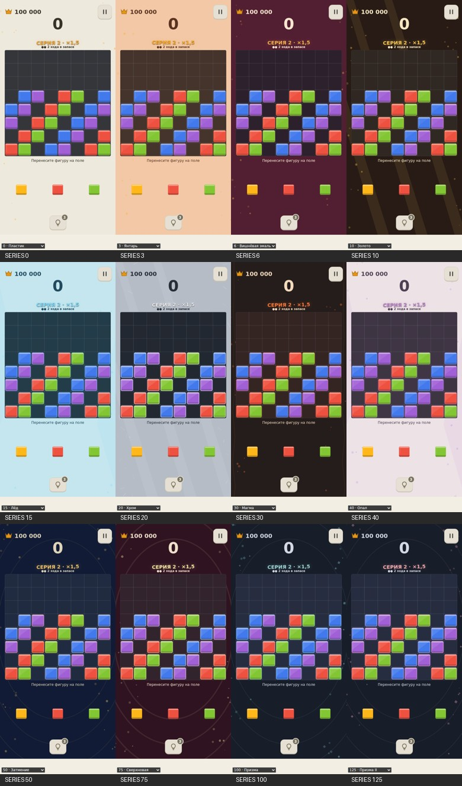
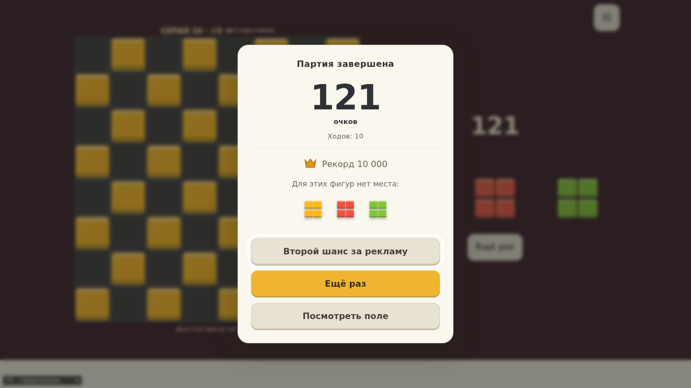

# Развитие серии — 0.20

Поручение: полный согласованный пакет от 30.10.2026. Счёт, правила, выдача, реклама и сохранённые версии партий не изменены. Тема вычисляется из сохранённой серии, отдельного прогресса темы нет.

## Реализация

- Высота очистки и добора очков определяется реальной серией (0/3/5/7/10/12/15/17 полутонов, потолок), включая возврат после паузы. Верхние ноты ограничены, чтобы длинная серия не превращалась в писк. Быстрая цепь влияет на насыщенность delay, не на сохранение высоты. Контакт постановки остаётся низким.
- Награды линий 1250 мс, цепи 1200 мс, важные 2100 мс. Предыдущие узлы отходят вверх и бледнеют. Максимум 3; вытеснение завершает только косметический добор, никогда не повторяет начисление. Отложенные рекорд/пустое поле учитываются до начала поражения. Скорость начисления прежняя.
- Поле реагирует светом, соседние клетки коротко пружинят; сильные серии дают боковые фонтаны. Похвала добавляет контурный блик. Полный исходящий импульс усиливает фон. Хитбоксы и готовность следующего хода не ждут эффектов.
- Поражение после наград: покачивание лотка, последовательное приглушение/проседание блоков, нисходящий звук и двойной native-пульс; панель через 750 мс. Для рекорда приглушение мягче, нисходящего звука нет. При revive подсвечиваются оставшиеся блоки, приглушение снимается. Calm пропускает анимированный финал.
- Пороги тем: 0,3,6,10,15,20,30,40,50,75,100. Названия: Пластик, Янтарь, Вишнёвая эмаль, Золото, Лёд, Хром, Магма, Опал, Затмение, Сверхновая, Призма. После 100 — четыре циклических акцента каждые 25 очисток.
- Изменяются фон, текст, поле, канты и отражения фишек/лотка. Цветовые классы фигур сохраняются. Переход повышения 1000 мс, сброса 1800 мс; исходящие круги 1200 мс. Интерполяция материала берёт текущее значение, CSS-переходы продолжаются из текущего цвета. Фоновые слои смешиваются текущими весами, без жёсткого сброса при быстрых изменениях.
- Ambient: 20–48 частиц на целевую тему, слои предыдущих тем затухают и отсекаются при весе <0,01; крайние зоны экрана, pointer-events:none, DPR <=1,5. Пыль, искры, кристаллы и металлические штрихи отличаются формой/цветом/движением. Очистки дают ограниченный импульс. В фоне/паузе RAF отменяется, calm убирает движение. Настройка теперь прямо поясняет отключение вибрации и активных анимаций.

## Что означает похвала

Отдельный Worker, 350 мс, лимит 3 млн проверок, кеш 2048 позиций. Итеративно сравниваются все первые ходы на глубине 1..остаток лотка; публикуется только последняя полностью законченная итерация. При отсечении следующей глубины сохраняется предыдущая, при незавершённой первой — похвалы нет. Ранг: число размещённых фигур, линии, мобильность всего каталога, меньше изолированных клеток.

Это лучший из вариантов на завершённой глубине, не обещание полного оптимума будущей партии. UI использует «Отличный ход», не «Лучший ход». Близкий вариант получает «Хороший ход», только если число фигур/линий совпадает, мобильность >=97% лучшей, изолированных дыр не больше на одну. На полях с <12 заполненных клеток, при единственном ходе и массовых равенствах похвалы нет. Между похвалами минимум 3 хода. Результаты привязаны к gameId/revision; worker отменяется при новом состоянии, паузе и запросе настоящей подсказки. Подсказка не показывается и не списывается этим анализом.

## Проверки и ограничения

Локально: production build и 86 unit прошли. Первый рабочий полный browser-прогон: 74/78, затем исправлены два ожидания старого текста и незавершённые CSS-переходы в pause/calm. Дополнительный прогон этих файлов: исправленные сценарии прошли; новые 3 сценария проходят (порог темы/запас/перезапуск, все DEV-темы без изменения сохранения, реальная похвала после worker). Найден и исправлен отрицательный радиус в первом RAF-кадре волны; новый тест отслеживает pageerror.

Финальный исходник `ed1e91a177204310f1dfce481a9681ba31b6171a`: CI 41017318211, verify job 123936494182 прошёл. 86 unit + 82 browser = 168 проверок. Android job 123938004767 также завершился успешно. После первого полного зелёного CI визуальный просмотр выявил недостаточный контраст заголовка/счёта на светлом результате; исправлено, добавлена проверка контраста >=4,5:1. Повторный полный CI включает это исправление и фоновые узоры/плавные акценты Призмы.

Видео 39,721 с с живым Web Audio: установка, линия, двойная очистка, пустое поле, серия с переходом темы, DEV-просмотр всех тем, поражение. Позиции явно подготовлены; обзор тем не является записью естественно достигнутой серии 125. Последний клип дополняется тишиной после остановки AudioContext, чтобы целиком показать панель результата. Скрины всех тем и двух компактных размеров — `evolution-0.20`. DEV-переключатель меняет только представление, поэтому сохранённый номер серии в HUD на обзоре остаётся прежним.

Аудиостресс Chromium: 20 наград через 100 мс, пик 0,3574, максимум 18 голосов; stop освобождает голоса/delay, после resume без события и при mute — тишина. Сырые данные: `evolution-0.20/audio-stress.json`.

 Физический телефон, сила вибрации, реальный FPS с рекламой и субъективное удовольствие не проверены. Полный браузерный прогон и аппаратная приёмка не взаимозаменяемы.

## Доставленная APK

PR CI [41017318211](https://github.com/DanilaH/blocky-block-puzzle/actions/runs/41017318211), artifact 12960257653, исходник `ed1e91a177204310f1dfce481a9681ba31b6171a`. 9 835 216 байт, SHA256 `f2cf7f13a99b6b0412bbc69b57c1fcccaf0e6eed225f0bdec47f7afeacf9a1c9`.

Binary manifest: `com.danilah.blocky.dev`, versionCode 20, versionName `0.20.0-preview`; VIBRATE присутствует. Все пять web-assets побайтово совпали с финальным dist, включая praise worker. В DEX присутствуют native haptics и audio-focus плагины; DEV theme selector отсутствует в production bundle. ZIP прочитан без ошибок.

SHA256 сертификата `e96d961e605c768113f398ccca8bf3e93aaed52ddb48c5d0c9b3f259f5fdbe13` совпал с доставленной 0.19. Это сравнение сертификата, не отдельная полная криптографическая проверка подписи. Физическая установка не выполнялась. Текущую партию можно продолжить; эффекты и тема работают по её сохранённой серии. Для новой шкалы очков при переходе с версии до 0.19 всё ещё нужна новая партия.
