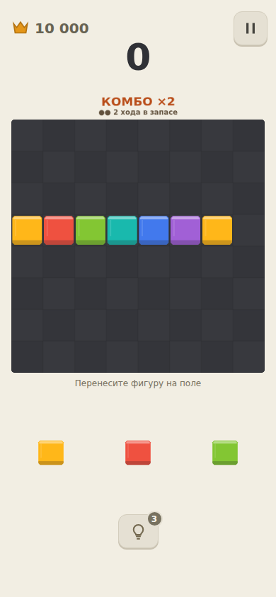
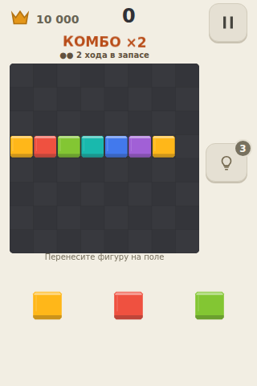
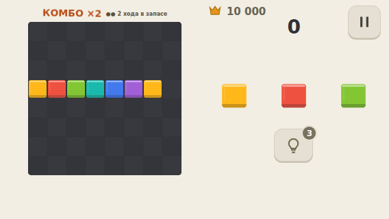
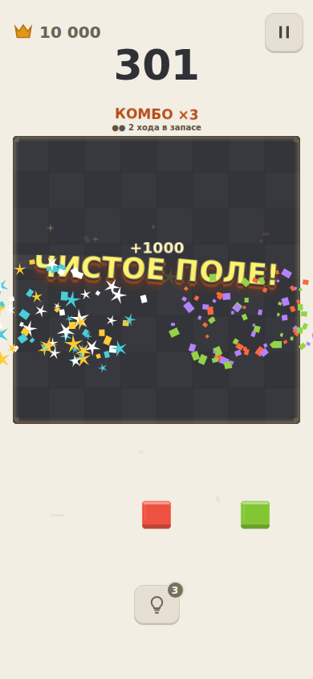

# Праздник, комбо, очки и вибрация — 0.19

Поручение владельца: ощутимо усилить отдачу, добавить native-вибрацию, явный рост высоты звука при быстрых очистках, отдельные награды и живой индикатор серии. Это намеренно более мощная проба; субъективная приёмка не заявляется.

## Правила и сохранение

Новые партии, создаваемые UI, получают `scoringVersion: festival-v3`. Существующие партии не пересчитываются. Базовая функция `newGame` оставлена совместимой с историческими тестами/симуляциями; UI явно выбирает новую шкалу. Клетка: 1; линии за ход: `50 × n × (n+1)` (100/300/600/1000 за 1/2/3/4, продолжение формулы для более крупных очисток). Множитель награды за линии по серии: 1/1,5/2/3/4/5, далее 5. Чистое поле: отдельно +1000, не умножается. Breakdown содержит placement/lines/combo/empty; их сумма — единственное начисление до публикации.

`legacyBest` и `festivalBest` разделяют рекорды. Исторический `best` остаётся общей верхней границей для совместимости валидатора/архива. Старый рекорд сохраняется при первом ходе новой шкалы; интерфейс показывает рекорд активной шкалы. Позднее восстановление старой партии не меняет её формулу. Настройка вибрации опциональна для старых профилей, default включён. Подсказки, выдача, RNG, стоимость ходов и запас двух подготовительных ходов не менялись.

## Представление

- Над полем: фактический множитель (для старой шкалы — номер серии), две точки запаса, предупреждение при нулевом запасе. Ожидание не сбрасывает серию. Idle-покачивание, реакция на повышение/расход, исчезновение при сбросе. Пауза и calm останавливают анимацию.
- Установка: усиленное сжатие/отскок. Очистка: более яркий белый след, увеличенный разлёт фрагментов, короткое смещение только canvas, отдельные звёзды/конфетти на viewport canvas с `pointer-events:none`.
- Линии и комбо показываются отдельно; пустое поле приходит после них: крупные анимированные буквы, +1000, два широких фонтана и особая виброотбивка. Рекорд имеет отдельный поздний акцент. Надписи подгоняются под маленькое поле.
- Очки линий летят к счёту после 140 мс, полёт 220 мс, добор 130–260 мс. Бонус пустого поля летит отдельно. Пауза/смена партии сбрасывают косметическую очередь и показывают полный сохранённый счёт. Быстрый следующий ход не ждёт ни салют, ни надпись.
- Новые фигуры появляются с более заметным отскоком. Кнопка повтора пульсирует подсветкой, не меняя область нажатия.
- Ограничения: 4 board impacts; до 240 частиц внутри поля и 360 на viewport, до 6 наградных узлов; 18 аудиоголосов. Viewport canvas работает только до окончания частиц и очищается при паузе/resize. Это лимиты, а не доказательство Android FPS.

## Звук и вибрация

Каждая очистка в пределах 2,8 с поднимает звук награды по ступеням 0/3/5/7/10/12/15/17 полутонов. Это отдельная косметическая музыкальная цепь: score-комбо не зависит от времени. После затухания/паузы звук начинает снизу, контакт установки не повышается. Усилена артикуляция награды, хвосты остаются ограничены allocator/limiter.

Собственный Capacitor `BlockyHapticsPlugin`, без копирования game-kit: короткая установка, двойная отбивка очистки с ростом по серии, отдельные рисунки рекорда и пустого поля. Сильная кульминация защищена от обрыва менее приоритетным следующим ударом. Android main thread, API 26+ waveform/amplitude с проверкой поддержки; API 24–25 и устройства без amplitude control используют on/off timing. Настройка, calm/reduced motion, pause/background/ad и destroy гасят вибрацию. Добавлено обычное разрешение `VIBRATE`, не запрашивается runtime-dialog.

Основания: [Android haptics APIs](https://developer.android.com/develop/ui/views/haptics/haptics-apis), [VibrationEffect](https://developer.android.com/reference/android/os/VibrationEffect), просмотрено 29.10.2026. На физическом моторе не проверено.

## Проверки

- `tests/festival.test.ts`: суммы, предел множителя, сохранение старой шкалы/полей/RNG, запас ходов, разные рекорды, музыкальные ступени и сброс.
- `e2e/festival.spec.ts`: одновременная двойная очистка/комбо/пустое поле, 1901 очко, отдельный +1000, mock native-вызов, пауза до отложенного эффекта, восстановление счёта/рекорда.
- Прежние тесты обновлены только под новую явную шкалу, отдельные версии рекордов и последовательность лейблов. Исправлены обнаруженные ошибки: движущаяся область кнопки, переполнение надписи, лишняя transition в calm/паузе; зарезервирована полоса HUD в коротком альбоме без перекрытия баннера. На 568×320 обычное поле 224 px (клетка 28 px), учебное без HUD — не меньше 240 px.
- CI 40938595566 на финальном исходнике: 82 unit + 74 browser = 156 проверок прошли (verify job 123675634138). Android job 123677362660 завершился успешно. До этого локальные проходы выявили/исправили layout и ожидания старых тестов; финальный полный зелёный результат относится к CI.

## Проверка шкалы на одинаковых ходах

`scripts/compare-festival.mjs`: 200 пар игр, seed 1–200, greedy по очисткам/свободному месту, предел 150 ходов. 9 374 хода, все партии закончились до предела. Поля, лотки и RNG каждой пары совпали.

Средний счёт 559,90 → 4401,375; средние 46,87 хода и 15,725 очистки не изменились. Комбо-бонусы дают 55,07% всех новых очков, пустое поле — 0,80%. Максимум в выборке 16 896 очков, максимальная серия 18; множитель остаётся ×5. Это измерение изменения шкалы, не доказательство удержания, человеческой сложности или удовольствия. Сырые данные: `feel-0.19/score-comparison.json`.

## Материалы и открытые проверки

Скрины 390×844/320×480/568×320 и пустого поля — `feel-0.19`. Видео 18,047 с записано из настоящего UI с живым Web Audio, на явно заданных позициях: установка, линия, пересечение, пустое поле, три последовательные очистки. Вибрацию видео не передаёт.

Открыто: физическая сила/рисунок вибрации, звук динамика/наушников, производительность с рекламой, субъективный праздник и читаемость при быстрой игре. Для новой шкалы при обновлении нужно начать новую партию. Production ads/signing/privacy и оставшиеся релизные gates не закрываются этим пакетом.

Аудиопроверка Chromium: 20 событий через 100 мс, максимум 18 голосов, измеренный пик 0,339; после stop 0 голосов, delay удалён, context suspended; после resume без нового события и при mute — тишина. Это синтезированный выход Web Audio, не измерение динамика телефона. Данные: `feel-0.19/audio-stress.json`.

## APK 0.19

Исходник `d542b24b2ced970b02a155ab4c4366ac55d0d3c1`, PR CI [40938595566](https://github.com/DanilaH/blocky-block-puzzle/actions/runs/40938595566), artifact `12925094132`. APK: 9 828 408 байт; SHA256 `41c7a581f3c67a0bbc5ba232ae37de016e0129792bef9f28cc0dbbae4cbc2a4a`.

Binary manifest: `com.danilah.blocky.dev`, versionCode 19, versionName `0.19.0-preview`, разрешение `android.permission.VIBRATE`. Web assets побайтово совпали с финальным локальным dist. В DEX присутствуют BlockyHapticsPlugin и BlockyAudioFocusPlugin. SHA256 сертификата `e96d961e605c768113f398ccca8bf3e93aaed52ddb48c5d0c9b3f259f5fdbe13` совпал с ранее доставленными preview; это сравнение сертификата, не отдельная криптографическая проверка APK подписи. ZIP прочитан без ошибок. Установка на физический телефон не выполнялась.

