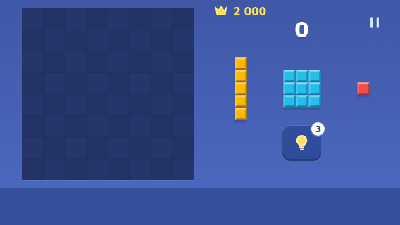
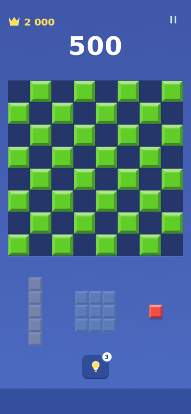
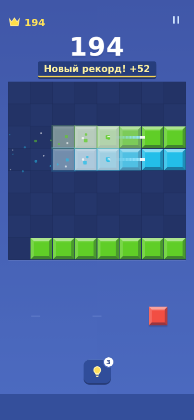
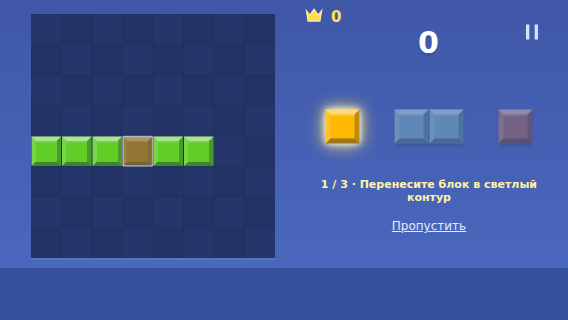
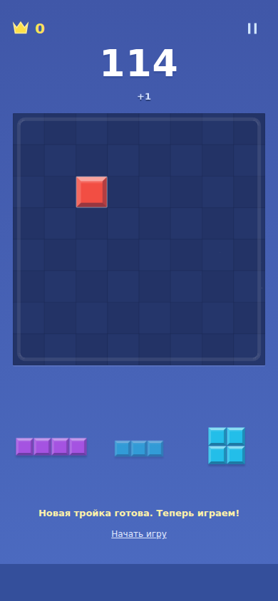

# 0.6 — читаемость, награды и обучение

Дата: 25.10.2026. Игровые изменения: `810619eee1574cf45c36d1c91d1ed5e4c3eee2d4`. Сборка с закреплённым Ubuntu 24.04 и явным путём ключа: `937420e58d9e752e9613654a29e4ef9ff48c0e0d`.

## Что изменилось

- Короткий landscape: статус расположен под правой колонкой; поле и фигуры больше. На 568×320 поле 244 px вместо 204, на 640×360 — 284 вместо 244. Клетки I5 в обоих случаях 18 px вместо 13; размер touch target этим числом не описывается. Портретная геометрия основной игры сохранена.
- Непомещающиеся сейчас фигуры имеют приглушённую графику и пояснение в accessible name. Они остаются выбираемыми; после освобождения места автоматически возвращается обычный вид. Уже использованные слоты по-прежнему пустые.
- «Серия N» вместо ложного намёка на множитель. Цвет счётчика усиливается до четвёртой ступени, очередная успешная очистка даёт краткий pulse. Формула очков не менялась.
- Обычная установка: локальная пружина и скромный +N на 450 мс; без постоянного pulse общего счёта. Линия: белый числовой акцент 650 мс. Комбо: более крупный золотой акцент с коротким увеличением, 1050 мс. Рекорд: отдельная плашка с наклонным появлением; чистое поле: раскрытие плашки и существующий контур поля. Один главный текст; рекорд/чистое поле не теряются в cooldown обычных похвал. Следующий ход разрешён во время эффектов. Calm/reduced-motion убирают движение, сохраняя смысл награды.
- Трёхшаговое обучение прямо на поле: установка, очистка строки, использование последней фигуры и появление новой тройки. Текущий шаг фиксируется только после успешной записи. Есть пропуск и повтор из «Как играть». Практика отделена от основной партии: не меняет её RNG, счёт, рекорд и кредиты. Старые сохранения не получают принудительное обучение.
- CI закреплён на Ubuntu 24.04: плавающий ubuntu-latest перешёл на неподдерживаемую нашим Playwright 26.04. Версии игровых зависимостей не менялись.

## Доказательства

[Измерения](feel-0.6/measurements.json) и [воспроизводимый probe](feel-0.6/probe.mjs).

| Сценарий | До 0.5 | После 0.6 |
|---|---|---|
| 568×320, поле / клетка I5 | 204 / 13 px | 244 / 18 px |
| 640×360, поле / клетка I5 | 244 / 13 px | 284 / 18 px |
| 390×844, поле / клетка I5 | 358 / 28 px | 358 / 28 px |
| Две фигуры без места | одинаковая активная подача всех трёх | opacity графики 0.34 / 0.34 / 1 |

### Одинаковая позиция, одинаковые действия

[Видео 0.5](feel-0.6/before.webm) · [Видео 0.6](feel-0.6/after.webm) · [Сценарий записи](feel-0.6/capture.mjs).

Оба ролика — настоящая браузерная игра с одинаковой заранее заданной позицией: комбо → рекорд → чистое поле. Позиция подготовлена через IndexedDB, ходы сделаны pointer drag. В начале есть короткая загрузка. Запись без звука; это не запись телефона и не обычная случайная партия.

[Расширенная запись](feel-0.6/play.webm): возврат фигуры, линия, пересечение, три линии, чистое поле, рекорд, результат, спокойные эффекты. В ней видны перезагрузки между тестовыми позициями.

## Проверка

- 16 unit-тестов: правила, профиль, сохранение, активность и детерминированность урока.
- 19 e2e-сценариев: прежние 15 плюс четыре проверки обучения/недоступных фигур. Дополнительно проверены ошибка записи шага и пропуска, повтор урока поверх начатой партии, восстановление шага после reload, обновление доступности после очистки.
- Production build проходит. Phaser остаётся большим чанком (~1.37 MB до gzip); предупреждение сборщика не скрыто.
- Просмотрены свежие скриншоты портрета/landscape, рекорда и обучения; просмотрены последовательности кадров видеозаписи. Замеры probe без pageerror.
- Во время проверки устранено наложение статуса на подсказку на 4 px: старый min-height сообщения конфликтовал с новой раскладкой. Тест сохранён.
- Перезагрузка тестом до окончания записи не является подтверждённым ходом. Тест восстановления ожидает опубликованный, уже сохранённый шаг перед reload.

## Ограничения

Это реализация оговорённого пакета 0.6, не закрытие всего M3. SFX-набор не менялся; субъективное качество звука, вибрация и реальная точность пальца на физическом Android не проверены. Визуальная приёмка остаётся за владельцем. Новые режимы, музыка, реклама и метаигра не добавлялись. Анимации не источник игрового состояния.

Подпись: в прежних CI-запусках кеш сообщал, что `~/.android/debug.keystore` не существует. Генерация и Gradle теперь явно используют этот путь. Это исправление ошибочного кеширования, не замена постоянному ключу в защищённом хранилище. Обновление поверх выданной 0.5 несовместимо по сертификату; удаление старого приложения удаляет его данные. Прежний приватный ключ из APK восстановить нельзя.

## APK и финальный CI

[Run 40174133486](https://github.com/DanilaH/blocky-block-puzzle/actions/runs/40174133486): verify и android — success. 16 unit + 19 e2e, production build и assembleDebug прошли. В логе подтверждено сохранение кеша ключа; повторное использование в будущем запуске ещё не проверялось.

- `blocky-preview-0.6.0.apk`, versionCode 6, 4 575 844 байта.
- SHA256: `a6333527b7597881aaed7474dbbfcea85666f5fe8c6c95bd6047628baeeec1a1`.
- SHA256 сертификата: `e96d961e605c768113f398ccca8bf3e93aaed52ddb48c5d0c9b3f259f5fdbe13`.
- Сертификат выданной 0.5: `5d70139462e6c90e24612e9c06ecbed34bb80a1b8c3b6bb1d57d8935b8cfd459` — отличается.
- Проверены наличие собранных web assets в промежуточном APK и сертификаты APK v2; установка на физическое устройство не выполнялась. Финальная пересборка меняет конфигурацию подписи, игровой код тот же.

