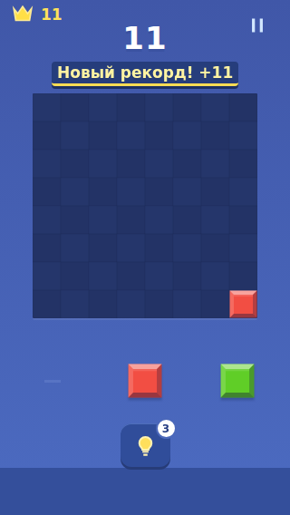
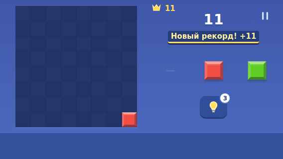

# 0.7 — читаемые награды и устойчивый интерфейс

Дата: 25.10.2026. Код сборки: `841f917c59d1d0a4423c92c73890610696adf71d`.

## Изменения

- Награда теперь занимает собственную строку под счётом. Проверяются пересечения на протяжении анимации на 320×568, 568×320, 640×360 и 390×844. Размер поля сохранён; в коротком landscape 568×320 — 244 px.
- Рекорд и чистое поле защищены от вытеснения следующими обычными ходами на 1050 мс. Полная непрозрачность — от 150 до 1050 мс, полная анимация — 1200 мс. Очки публикуются сразу после сохранения, ввод не блокируется.
- Второе важное событие ждёт в одном слоте. Последующее важное событие заменяет ожидающее; длинная очередь не копится. Пауза и фон очищают показ и ожидание. Финальный результат учитывает время защищённой награды.
- Подпись подсказки вычисляется из состояния: «Ищем ход…», «Показать ход», «Подсказки завтра» или «Подсказка». Фокус/отмена больше не подменяют её общей подписью.
- В коротком landscape скорректирована высота строки статуса, чтобы она не пересекала подсказку.

## Доказательства

[Быстрый следующий ход, затем пауза; обычный и спокойный режим](feel-0.7/rapid-rewards.webm).

[Две важные награды подряд и отмена ожидающей награды при фоне](feel-0.7/pending-rewards.webm).

Это записи браузерных тестов без звука. Позиции подготовлены через IndexedDB; между сценариями видны перезагрузки. Они не заменяют проверку на телефоне.

## Проверка

Локально: 16 unit + 23 e2e прошли, production build успешен. После корректировки временных ожиданий повторно прошли четыре сценария обучения и четыре сценария наград. Новые e2e проверяют быстрые ходы с немедленным счётом, непрозрачность по времени самой анимации, пересечения на каждом кадре, два важных события, паузу/фон, исчерпанные и кешированные подсказки.

При полном прогоне устранены две гонки тестов: измерение непрозрачности после произвольной задержки действий браузера и reload до подтверждения сохранённого пропуска обучения. Проверки не отключены; ожидания привязаны к анимации и опубликованному состоянию.

Предупреждение о большом Phaser-чанке остаётся. Игровые правила, эффекты поля и SFX в этом пакете не менялись. Проверка звука, вибрации, установки обновления и удобства пальцем на физическом Android остаётся открытой.

## Финальный CI и APK

[Run 40176963774](https://github.com/DanilaH/blocky-block-puzzle/actions/runs/40176963774): verify и android — success. Все 16 unit и 23 e2e, production build и assembleDebug прошли.

- `blocky-preview-0.7.0.apk`, versionCode 7, 4 576 172 байта.
- SHA256 APK: `c42b3056e7a404c6a8588ce30829b6c82382b5e8e4c8a04bef5354caaa54008f`.
- SHA256 сертификата: `e96d961e605c768113f398ccca8bf3e93aaed52ddb48c5d0c9b3f259f5fdbe13` — совпадает с выданной 0.6.
- Application ID сохранён, versionCode увеличен: сборка рассчитана на обновление поверх 0.6. Фактическая установка обновления на устройство не проверялась.
- Все production assets сравнены побайтно с файлами внутри APK — совпадают.
