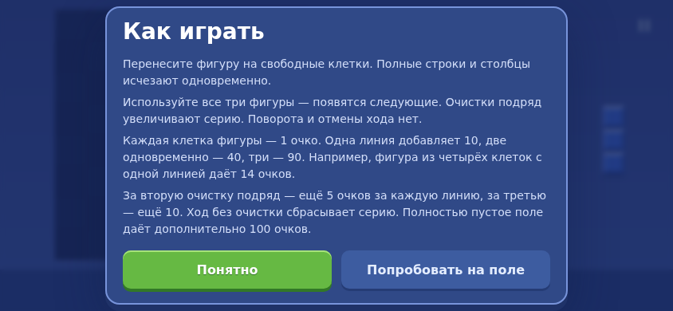
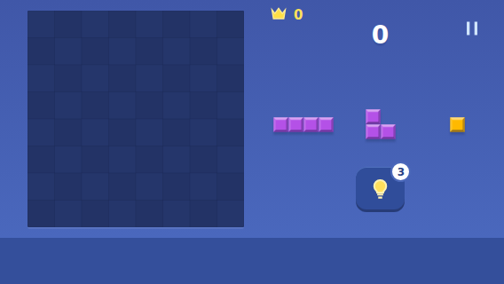

# Preview 0.8 — настройки, отклик и пауза

25.10.2026. Код сборки: `2da68ea3161e6d9393899a0ff60e79ca829707d4`.

## Что исправлено

- На время записи настройки оба переключателя блокируются. После успешной записи, отказа из-за занятого хранилища или ошибки checked синхронизируется с подтверждённым состоянием. Второе действие нельзя молча потерять за включённым checkbox.
- Основной удар установки имеет приоритет 2, его дополнительные слои — 1; второстепенные хвосты — 0. При заполненных шести голосах установка вытесняет низкоприоритетные голоса. Новые декоративные голоса не вытесняют удар. При равном приоритете сохраняется более свежий отклик. Новые тембры и музыка не добавлялись.
- Цикл Phaser засыпает, когда координатор блокирует игру паузой, фоном или потерей WebGL. Возвращается только при снятии всех блокировок; обработаны первый кадр загрузки, pagehide/pageshow и HMR. После восстановления WebGL убирается соответствующее сообщение.
- Подсказка и пропуск обучения в коротком landscape получили 48 px. Лоток уменьшен по высоте со 100 до 96 px, отступ обучения скорректирован. Размер поля сохранён: 244/284/314 px на 568×320/640×360/844×390.
- В существующих правилах появились примеры стоимости клеток, мультиочистки, серии и бонуса +100 за пустое поле.

## Проверка

Локально прошли 18 unit и 26 e2e, production build. Новые проверки покрывают лимит голосов и приоритет установки, быструю смену настроек при задержке записи, откат после ошибки, остановку рендера на паузе, сочетание паузы и фона, resize и искусственную потерю/восстановление WebGL, размеры кнопок и доступность правил.

Две ошибки тестового сценария устранены без ослабления требований: откат checkbox проверяется обычным кликом, поскольку `uncheck()` требует, чтобы состояние оставалось снятым; измерение кнопки обучения ждёт подтверждённого перехода после записи.

Повторные отдельные probes относительно аудита 0.7:

| Сценарий | 0.7 | 0.8 |
|---|---|---|
| Пауза, Phaser postrender за 2 секунды | 120 | 0 |
| Неподвижная активная игра за 2 секунды | 120 | 121 |
| Захват и установка через 100+20 мс после рекорда | 0/3 голоса установки | 3/3 |
| То же после чистого поля | 0/3 голоса установки | 3/3 |
| Две настройки при задержке записи | calm виден включённым, сохранён выключенным | UI, сохранение и reload совпадают |

Лимит шести голосов сохранён. Пульсация подсказки и активная игра продолжают рендериться; рендер по требованию для неподвижной активной игры не реализован. Замеры браузерные, выигрыш батареи на Android не измерялся. В дополнительных UI-пробах pageerror отсутствуют.

## Материалы

[Быстрые ходы](feel-0.8/rapid-moves.webm) · [Пауза и восстановление WebGL](feel-0.8/renderer-recovery.webm).

Записи браузерные, без звука. Позиции быстрых ходов подготовлены тестом; между сценариями присутствует перезагрузка. Звуковая проверка — инструментирование AudioContext и unit-тесты, не субъективная оценка звучания.

В папке `feel-0.8`: `verify.mjs`, `audio-verify.mjs`, сырые `results.json` и `audio-results.json`. Запуск из корня при работающем Vite на 5173.

## Ограничения

Физическая установка обновления, работа пальцем, внешний audio focus, субъективные тембры и энергопотребление не проверены. Релизные SDK, музыка/вибрация и прочие незакрытые пункты основной роудмапы этим пакетом не закрываются. Предупреждение о большом Phaser-чанке остаётся.

## Финальный CI и APK

[Run 40195344788](https://github.com/DanilaH/blocky-block-puzzle/actions/runs/40195344788): verify и android — success; 18 unit + 26 e2e, production build и assembleDebug прошли.

- `blocky-preview-0.8.0.apk`, versionCode 8, 4 576 756 байт.
- SHA256 APK: `18a24e444edb874b677afbc6e9322a8ae5ca78d268fd7a5051f58d5f44d7ce94`.
- Сертификат SHA256: `e96d961e605c768113f398ccca8bf3e93aaed52ddb48c5d0c9b3f259f5fdbe13` — совпадает с выданной 0.7.
- Application ID сохранён; сборка рассчитана на обновление поверх 0.7. Установка на физический Android не выполнялась.
- После свежей локальной production-сборки все assets побайтно совпали с файлами внутри финального APK.
