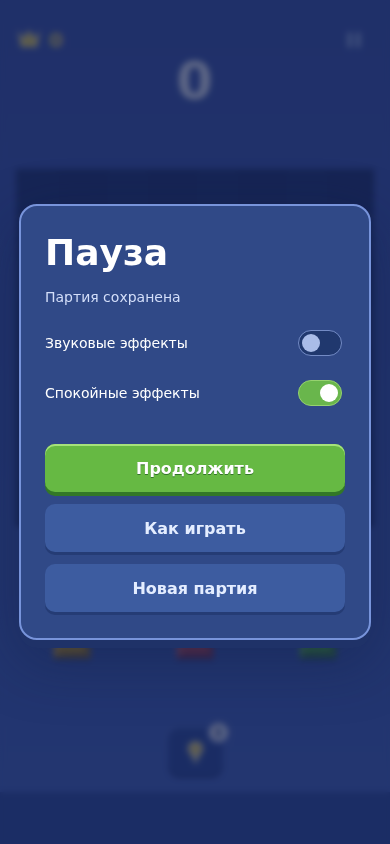
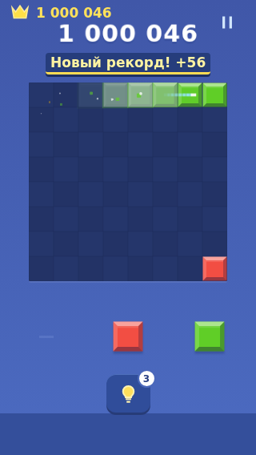
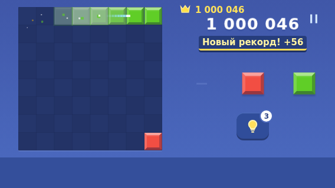

# Независимый проход 0.7: функционал, оптимизация, UI, UX и feel

25.10.2026. Проверен commit `e3afb76d0c4238600f584d8119ae9c8d85f3e314`, игровой код сборки `841f917c59d1d0a4423c92c73890610696adf71d`. Игровой код в этом проходе не менялся.

## Вывод

Ядро и новая раскладка выдержали проверку. Поводов заново менять всю тему не найдено. Следующий полезный пакет — сохранение настроек, приоритет звуков установки, остановка рендера на паузе и размер компактных кнопок. Успешные автотесты не означают магазинную готовность или принятие звука на телефоне.

## Подтверждённые находки

### P2 — переключатель показывает несохранённую настройку

В `src/main.ts`, обработчик настроек в `showPause`, результат `store.update()` игнорируется. Пока другая запись занята, `ProfileStore.update()` возвращает false. Второй checkbox уже переключён браузером, но render не синхронизирует его checked с сохранённым состоянием.

Воспроизведение: задержать `IndexedSave.write` на 500 мс; выключить звук, сразу включить спокойные эффекты. На экране `{sound:false, calm:true}`, в сохранении `{sound:false, calm:false}`. После reload спокойные эффекты выключены. Внедрение задержки моделирует медленную запись, частота на устройстве не измерена.

Исправление: сериализовать изменения настроек либо явно блокировать переключатели до окончания записи; при отказе/ошибке всегда возвращать UI к подтверждённому значению. Не терять последнее действие молча.

### P2 — быстрый следующий ход может остаться без звука установки

В `src/game/audio.ts`, `tone()` просто отбрасывает новый голос при `voices.size >= 6`; приоритетов нет. Рекорд занимает четыре голоса, захват через 100 мс добавляет два, установка ещё через 20 мс теряет все три своих голоса. После чистого поля результат тот же. Проверено реальным AudioContext и инструментированием планировщика: для `record→place` и `allClear→place` принято 0 из 3 голосов.

Это дефект планирования отклика. Он не доказывает, что сами тембры хорошие или плохие. Лимит шесть оставить, но резервировать основной удар установки либо вытеснять второстепенные хвосты. Проверять быструю серию событий, а не только отдельные звуки.

### P2 — рендер продолжает работать на паузе

За две секунды неподвижной игры — 120 событий Phaser `postrender`; при открытой паузе — тоже 120. Перестроений Graphics в обоих случаях ноль: геометрия уже не пересчитывается, но цикл рендера не остановлен. При открытой подсказке — 120 кадров и 120 перестроений Graphics за две секунды.

Исправление: связать остановку/возобновление Phaser с агрегированным состоянием активности; сохранить корректный resize и восстановление контекста. Рендер по требованию в неподвижной игре — отдельная необязательная оптимизация после замера на телефоне. По этому тесту нельзя количественно утверждать расход батареи или выигрыш fps.

### P2 — часть элементов в коротком landscape ниже собственного минимума touch target

На 568×320, 640×360 и 844×390 кнопка подсказки имеет высоту 44 CSS px; `.lesson-skip` задаёт минимум 40 px. В ТЗ задан ориентир 48 dp. Измерение браузерное, физический размер на телефоне не проверен. Увеличить интерактивную область с сохранением границ статуса и баннера; не уменьшать поле ради декоративных отступов.

### P3 — правила не объясняют начисления

`showRules()` объясняет очистку и серию, но не стоимость клеток, мультиочистки и +100 за пустое поле. Игрок видит +56 или +100, но не может понять систему через помощь. Добавить короткие примеры в существующий экран правил, без нового обязательного обучения.

## Что прошло

- Свежие 16 unit + 23 e2e, production build — success. Включены сохранение и резервная копия, обучение, отмены переноса, поворот, ошибки записи, возврат из паузы, подсказки, результат и защищённые награды.
- Дополнительный независимый расчёт: 200 детерминированных партий случайного допустимого игрока, 2 994 хода, 412 352 проверки размещения. Отдельная реализация размещения/очистки/очков не нашла расхождений; входное состояние не изменяется, устаревшая revision отклоняется, повторный расчёт идентичен, полученные профили валидны. Все 200 партий закончились до лимита 150 ходов. Это не оценка человеческого баланса или длительности сессии.
- 30 подсказок на более заполненных позициях: все допустимы, поиск завершился без отсечения; максимум 12,2 мс. Ещё 12 пустых начальных полей через настоящий worker: все ходы допустимы, все поиски отсечены по бюджету; поиск до 180,2 мс, worker от создания до ответа 195,4–212,3 мс. Это не полный пользовательский путь до показа и не замер минимального Android.
- На хосте p95 вычисления `applyMove` — 0,1 мс, максимум 3,9 мс. Не основание менять движок или вводить сложное кеширование ядра.
- Восемь размеров: 320×480, 320×568, 360×640, 390×844, 568×320, 640×360, 844×390, 768×1024. Стресс-позиция: миллион очков, серия 10, новый рекорд. Награда не пересекает счёт; подсказка не пересекает баннер. Серия при особой награде скрыта намеренно. Поле на 568×320 осталось 244 px; на 320×480 — только 160 px, это отдельный компромисс очень короткого портрета.
- В дополнительных UI-пробах нет pageerror. Просмотрены реальные скриншоты компактного портрета, landscape и настроек.

## Оценка оформления и фила

Композиция стала устойчивее: поле читается, награда отделена от счёта, длинные числа помещаются. Самобытность оформления всё ещё слабая — это субъективная оценка, а не найденная поломка. Очередная смена палитры сейчас менее полезна, чем стабильный отклик каждого действия. Эффекты поля ограничены двумя живыми событиями и 120 частицами; звук ограничен шестью голосами, но текущая политика их распределения мешает быстрому вводу.

При пульсации подсказки поле целиком перестраивается, а отрисовка граней создаёт временные Vector2 и массивы. Это кандидат для профилирования на слабом устройстве, не доказанный источник лагов: на текущем хосте 120 перестроений заняли суммарно около 6,6 мс CPU за две секунды.

## Границы и следующий пакет

P0/P1, потери принятого хода или поломки подсчёта в проверенных сценариях не обнаружены. Это не доказательство отсутствия всех ошибок. Браузер Chromium, Vite dev для дополнительных probes, отдельная production-сборка; физический Android, энергопотребление, субъективный звук, внешний audio focus и ощущение пальца не проверены.

Реклама/revive/аналитика, музыка/вибрация и полный релизный набор настроек остаются незакрытым scope роудмапы; они не объявлены новыми регрессиями 0.7. Политика выдачи всё ещё требует сравнения и человеческого плейтеста.

Рекомендуемый порядок: настройки → звуковые приоритеты → пауза рендера → интерактивные области и пояснения очков → APK и плейтест на устройстве. Новый редизайн, метаигру и переписывание ядра в этот пакет не включать.

## Воспроизводимость

Папка [audit-0.7](audit-0.7/) содержит `probe.mjs`, `core-probe.mjs`, `audio-probe.mjs`, `hint-probe.mjs`, исходные JSON-результаты и снимки. Запускать из корня репозитория при работающем `npm run dev -- --port 5173`: `node docs/qa/audit-0.7/<probe>.mjs`. Пробы создают отдельный браузерный профиль, меняют только его тестовое IndexedDB и runtime-прототипы; исходники игры не модифицируют.
