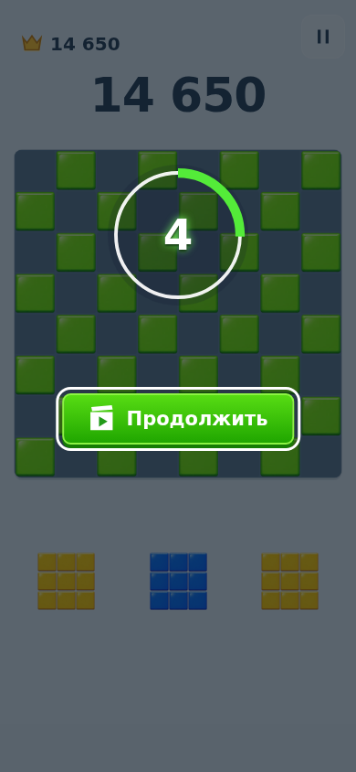
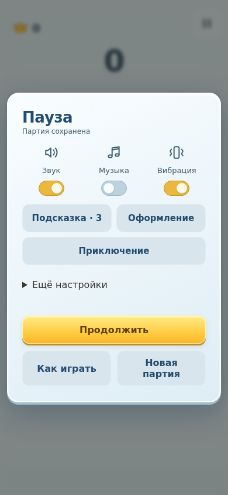
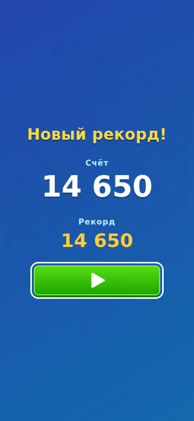
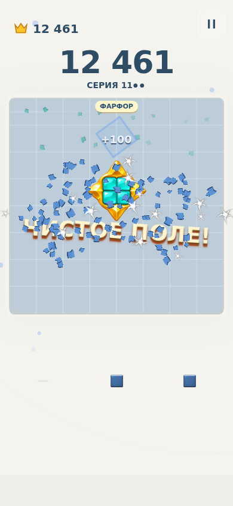

# Preview 0.42 — поле в центре внимания

## Основание
Повторно изучена предоставленная запись 7:39 (576×1280), а не только воспоминание об оригинале. Контрольные участки: preview будущих линий 0:24, 0:31, 4:30–4:36; смена оформления 1:36–1:39, 5:31–5:39, 6:05–6:22; предложение revive 2:33–2:37, реклама 2:38–2:51, результат 2:52–2:54; пауза 2:58. По видео нельзя точно измерить расстояние от пальца: сам палец не виден.

## Реализация
- Реальный board под затемнением, кольцо и одна зелёная кнопка. Нет карточки, мини-карты, пояснения и отдельного отказа. Срок сохраняется; принятие не теряется при недоступной рекламе. Back завершает выбор.
- Interstitial перенесён на окончательное поражение, резервирование и completed game IDs сохраняются до SDK. Повтор не показывает его заново. Ошибка SDK не блокирует результат.
- Отдельный синий результат с заголовком, счётом/рекордом и одной кнопкой ▶. Нет остаточных фигур, счётчика ходов и обзора поля.
- Обычная подсказка «Перенесите фигуру» скрыта вне обучения. Серия занимает одну короткую строку с двумя точками запаса. Постоянное покачивание выключено, реакция на изменение остаётся.
- Миниатюры лотка используют клетку до 48% клетки поля, вместо изменения масштаба по размеру крупнейшей фигуры. Области захвата сохранены.
- Пауза: три быстрых переключателя с SVG-иконками, подсказка/оформление/кампания, раскрываемые ползунки и спокойный режим. Диагностика скрыта в production.
- Один главный заголовок награды; предыдущий уступает следующей награде или drag. Очки продолжают движение. Две оригинальные эмблемы, 45,394 байта WebP / 722,304 байта decoded RGBA; загрузка до события.
- Preview полных линий дополнен непрерывной белой обводкой каждой завершённой строки/колонки; используется тот же расчёт постановки и переиспользуемый буфер счётчиков. Существующая последовательность смены темы сохранена. Выдача и подсчёт не изменены.

## Проверки
Локально: 144 unit; адресный браузерный прогон 23/23; production build и alpha/trim/budget checks прошли. Полный локальный прогон: 120/124; старые проверки контраста/размера лотка обновлены под новое оформление. На ресайзе паузы обнаружено переполнение кнопок, исправлены grid/min-width; ожидание завершения ресайза проверяется polling. Повтор связанных сценариев: 19/19 (темы, выдача, drag, музыка, читаемость лотка), включая проверку неизменного размера при трёх составах лотка. Последний повтор паузы/музыки: 6/6. CI [41849463134](https://github.com/DanilaH/blocky-block-puzzle/actions/runs/41849463134): 144 unit + 124 browser прошли (verify job 126641546692); assets:check и production build прошли. Android unit/build job 126645948800 тоже прошёл.

## Визуальная проверка
Просмотрены предложение 390×844 и 568×320, пауза и fullscreen result. Исправлены наложение старых CSS на quick toggles и лишняя кнопка повтора под затемнением. Клавиатурный focus outline намеренно сохраняется.

`scripts/record-minimal42.mjs` воспроизводит паузу, таймаут и результат, затем принятое предложение и mock reward.

## Ограничения
Запись браузера использует подготовленное поражение и явную имитацию rewarded, не настоящий SDK. Физический Android, аппаратные вибрации, слышимость и человеческая оценка остаются открытыми.

`scripts/capture-rewards42.mjs` проверяет появление загруженной эмблемы на подготовленной полной очистке. Просмотрен runtime-кадр: прозрачные края, эмблема над заголовком, поле остаётся видимым.

Дополнительно production-пауза проверена на 320×480: расширенные настройки доступны, диагностика скрыта. `verify-upgrade.mjs` перенёс профиль с web payload APK 0.41 на текущий production dist в том же origin: game/RNG, records, settings, hint credits, pending/applied reward intents и receipt markers совпали точно. Это не установка APK на телефон.

## Проверенный APK
- Application/CI commit: `7a55360d0ede5ce36863320e69cc75687ddf9cfb`.
- PR-run `41849463134`, APK artifact `13335825688`.
- `com.danilah.blocky.dev`, versionCode 42, versionName `0.42.0-preview`.
- SHA-256: `b5fb8ad87f495daf639a1de282269bf251c099775cc072e9e938cc53010fc0ea`.
- ApkVerifier: verified; сертификат `e96d961e605c768113f398ccca8bf3e93aaed52ddb48c5d0c9b3f259f5fdbe13`, совпадает с 0.41.
- Все 78 production-файлов совпали с локальным dist побайтно; [машинный протокол](minimal-0.42/apk-verification.json).
- Видео `blocky-0.42-ui.mp4`: 26,4 секунды, пауза → timeout/result → mock rewarded → полная очистка с оригинальной эмблемой; подготовленные позиции.
