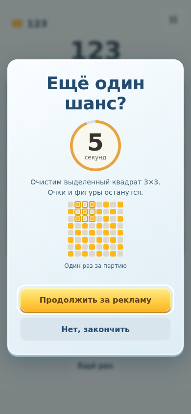
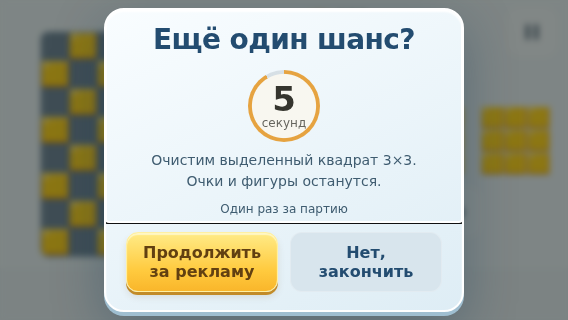
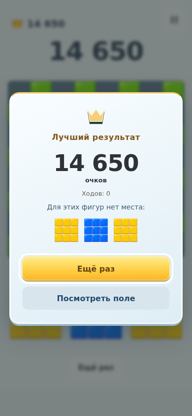

# Preview 0.41 — отдельное предложение revive

## Изменение
Реализовано прямое уточнение владельца (D37). После реакции на поражение появляется отдельное предложение с круговым отсчётом 5 секунд. Результат/счёт/повтор не показываются внутри предложения. «Продолжить за рекламу» сохраняет выбор и сразу запускает рекламный контур; второго подтверждения нет. Отказ, Back или таймаут открывают окончательный результат без кнопок revive.

Срок хранится в сохранении и не продлевается от перезапуска или сворачивания. Принятое решение сохраняется при медленной/недоступной рекламе: можно повторить показ либо окончательно закончить. Награда применяется только после подтверждённого receipt, по-прежнему один раз. Архивные уже заработанные права остаются в паузе.

## Проверки
- Локально 142 unit прошли при `--maxWorkers=2`. Первый запуск 24 параллельных workers получил два пятисекундных таймаута в существующих тестах выдачи, без assertion failures; изолированный запуск прошёл без изменения тестовых ограничений.
- Адресный браузерный прогон: 27/29 с первого раза; два теста требовали обновления под новый порядок экранов (ожидание сохранения предложения перед внешней записью fixture; отказ перед проверкой результата). Повтор ads + usability: 15/15.
- Отдельные проверки: нет счёта/повтора до выбора; таймаут и перезапуск; сохранённое принятие при недоступной рекламе; Back окончателен; один клик до rewarded; повторный receipt не дублирует награду; interstitial только после финального повтора.
- Дополнительная проверка Chromium CDP: заморозка вкладки (`Page.setWebLifecycleState: frozen`) на 6 секунд, затем `active`; окончательный результат появился в пределах 3 секунд, кнопки revive нет. Это браузерная имитация приостановки, не аппаратный Android.
- Локальные production build и asset checks прошли.
- Первый полный CI 41834518134: 142 unit, 122/123 browser. Единственное падение — старый showcase ожидал финальный результат раньше пятисекундного предложения. Исправлен явным отказом после появления отсчёта; код приложения не менялся. Локальный повтор showcase: 1/1. Итоговый CI 41836284839: 142 unit + 123 browser прошли; Android unit/build также прошли (job 126601329194).

## Визуальные доказательства
Просмотрены screenshots 320×480, 568×320, 390×844: отсчёт и обе кнопки доступны, без горизонтальной прокрутки. В короткой горизонтальной ориентации мини-карта скрыта, область очищения сохраняет текстовое описание.

`scripts/record-revive41.mjs` записывает подготовленное поражение: таймаут → результат, затем новое предложение → одна кнопка → имитация rewarded → продолжение. Это браузерная запись, рекламный bridge подменён явно подписанной тестовой наградой. Не естественная партия и не показ настоящего рекламного SDK.

## Ограничения
Физический Android, реальная реклама, аппаратный Back/сворачивание во время SDK и субъективное восприятие не проверены на телефоне. Пятисекундный wall-clock и сохранения проверены браузерными/ядерными тестами. Покадровое совпадение с оригиналом не заявляется: референс-видео в этом проходе не пересматривалось.

## Проверенный APK
- Application commit: `801bb55aa06783095b457a81d1624ccc0c655094`; test-fix/CI commit: `df9a55c8013511e03cae2c28b3c01c815979c3f3`.
- PR-run [41836284839](https://github.com/DanilaH/blocky-block-puzzle/actions/runs/41836284839), artifact `13327907414`.
- `com.danilah.blocky.dev`, versionCode 41, versionName `0.41.0-preview`.
- SHA-256: `66fe4b78afc12129025a606664c2147196788eec3855b66ef96425b309f84c6e`.
- ApkVerifier: verified; сертификат `e96d961e605c768113f398ccca8bf3e93aaed52ddb48c5d0c9b3f259f5fdbe13`, совпадает с 0.40.
- Все 76 production-файлов совпали с локальным `dist` побайтно. [Машинный протокол](revive-0.41/apk-verification.json).
- Видео `blocky-0.41-revive.mp4`: 13,16 секунды, подготовленная позиция и имитация рекламной награды.
