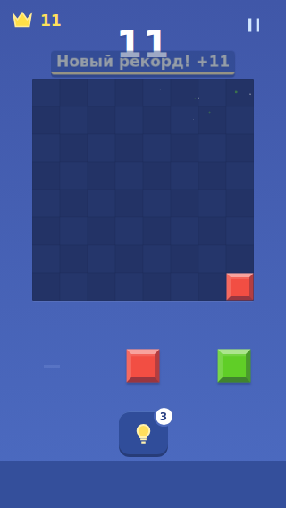
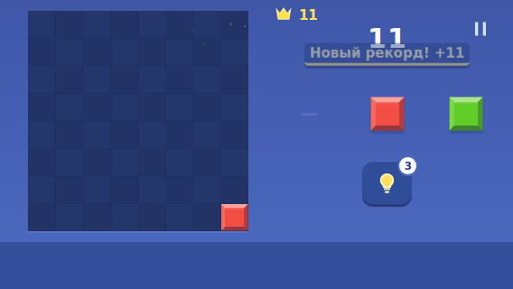
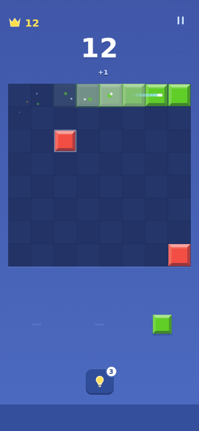
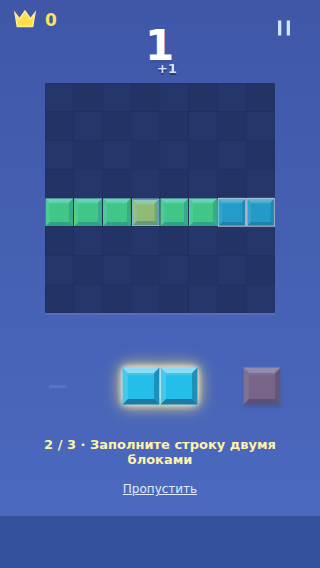

# Независимый повторный проход 0.6: UI, UX, feel

25.10.2026. База: `3967ca797d8dd293448643081748213b81593e88`. Это отдельный критический проход тем же ассистентом, не внешняя экспертиза и не исследование с игроками. Игровой код в этом проходе не менялся.

## Главный вывод

0.6 заметно улучшила обучение и ясность действий. Однако воспринимать её как законченную переработку feel преждевременно: изменились преимущественно подача наград и интерфейс; `BoardScene.ts` и `audio.ts` между 0.5 и 0.6 не менялись. Само по себе это не дефект — уже работавшую очистку незачем переписывать ради номера версии. Но прежний вывод «разные награды работают» был слишком широким: свежий быстрый сценарий выявил потерю приоритета рекорда, а компактные размеры — пересечение плашки со счётом.

Рекомендация: короткий пакет исправлений трёх воспроизведённых проблем, затем реальный телефон и прослушивание. Новый большой редизайн без этого даст меньше полезной информации.

## Метод

- Новый браузерный probe, без изменения игровой реализации: быстрые последовательные ходы, рекорд на четырёх размерах, большой счёт, обучение на 320×568 и в двух landscape-размерах, подпись исчерпанной подсказки после blur/focus.
- [Сценарий 1](audit-0.6/probe.mjs), [замеры 1](audit-0.6/measurements.json), [сценарий 2](audit-0.6/edge-probe.mjs), [замеры 2](audit-0.6/edge-measurements.json). Запускать при работающем Vite на 5173. Искусственные позиции сохранены через IndexedDB, действия выполнены через UI. Первый probe не зафиксировал pageerror.
- Снова загружены официальные видеопревью Block Blast и Woodoku; просмотрены последовательности кадров с шагом 2 секунды. Это визуальный анализ рекламных записей, не плейтест установленных конкурентов и не измерение их latency.
- Заново открыты официальные карточки и Easybrain; отдельно использована независимая веб-реализация как источник одного UX-паттерна. Нельзя приписывать её поведение официальному Blockudoku.
- Полный набор 35 тестов в этом аудите повторно не запускался: он прошёл в CI реализации 0.6. Новые probes проверяют то, что эти тесты не покрывали: геометрическое пересечение наград и их вытеснение обычным ходом.
- Реальный Android, субъективный звук/вибрация, нагрузка на батарею и удержание здесь не проверялись.

## Сравнение с конкурентами

| Область | Что подтверждено у ориентира | У нас в 0.6 | Решение |
|---|---|---|---|
| Главный экран | В превью Block Blast доминируют поле, счёт и свободный лоток | Та же ясная основа; короткий landscape стал крупнее | Сохранить композицию; не возвращать лишние панели |
| Различимость наград | В превью Block Blast отдельные Good, Combo с растущим числом и New high score; у Woodoku отдельная подача рекорда | Типы уже различаются визуально, но общий burst заменяется каждым ходом | Исправить жизнь важной награды, не просто увеличить шрифт |
| Связь действия и результата | В ролике Block Blast локальное выделение очистки, текст комбо и реакция счёта работают на одно событие | Волна читается; награда вынесена в верхнюю строку, что сохраняет прицеливание | Нужна согласованная последовательность и минимальная длительность важного акцента; не копировать перекрытие поля |
| Цельность оформления | Woodoku связывает поле и фигуры одним материалом и световыми акцентами | Блоки согласованы, но синий экран с короной очень близок к Block Blast | Собственный характер — последующий вопрос типографики/звукового мотива, не новая полная перекраска |
| Серия и комбо | Easybrain отдельно описывает несколько очисток за ход и успешные ходы подряд | «Серия N» теперь честная; комбинации линий обозначены отдельно | Прежняя претензия закрыта; баланс не менять ради текста |
| Доступные фигуры и preview | Автор blocksudoku.com описывает осветление непомещающихся фигур и предварительное выделение очищаемых областей | Оба паттерна присутствуют | Это уже полезный уровень ясности. Новую систему выбора не добавлять |
| Первые действия | Ролики показывают причинность «поставил → исчезло → получил очки», но не доказывают реальный first-run конкурентов | Теперь три интерактивных шага, контур цели, пропуск и повтор | Не усложнять обучение; проверить понимание на человеке |
| Конец партии | Отзыв Woodoku от 29.07.2025 жалуется на невозможность рассмотреть последний ход из-за рекламы | Есть задержка последней очистки и возврат к финальному полю | Сохранить это при будущей интеграции рекламы; один отзыв не характеризует все версии конкурента |
| Звук и осязание | Магазинные описания обещают sound effects; по кадрам качество не устанавливается | По коду есть разные сигналы и лимит голосов; набор не менялся в 0.6 | Следующий новый тип доказательства — прослушивание/игра на устройстве |

Это сравнение решений, не утверждение, что у конкурентов всё лучше. Карты уровней, события, валюты и магазины здесь не нужны.

## Воспроизведённые проблемы

### P1 — плашка награды перекрывает счёт на компактных экранах

На обычном рекорде 11 очков, без экстремально длинного текста, замер через примерно 400 мс после хода:

| Viewport | Вертикальное пересечение прямоугольников счёта и плашки |
|---|---:|
| 320×568 | 14.6 px |
| 568×320 | 10.6 px |
| 640×360 | 10.6 px |
| 390×844 | 0 px |

Прямоугольники пересекаются также по горизонтали; скриншоты подтверждают визуальное наложение. Это дефект компактной компоновки награды в 0.6, а не недостаток длинного счёта.

Исправление: выделить награде достаточную отдельную строку, учесть её высоту и overshoot в компактном layout. Проверять одновременно score, best, reward и поле. Не решать проблему возвратом к полю 204 px или уменьшением надписи до нечитаемой.

### P1 — обычный следующий ход стирает рекорд

Сценарий: одиночная очистка даёт 11 и новый рекорд; следующий одиночный блок даёт +1. После появления текста рекорда следующий ход заменил его за 177 мс в этом прогоне. Это интервал конкретного автоматизированного сценария, не фиксированная длительность игры и не замер восприятия человеком.

В коде каждый принятый ход очищает таймер, отменяет анимацию burst и заменяет его текст. `recordCelebrated` уже выставлен, поэтому отдельная награда рекорда в этой партии повторно не появляется. Cooldown защищает от фильтрации при создании, но не от вытеснения после создания.

Исправление: отдельное состояние приоритета и минимальной видимости значимого события. Очки должны обновляться сразу; обычный +N не должен стирать рекорд/чистое поле. Не блокировать следующий ход и не накапливать длинную очередь устаревших похвал. Ориентир для проверки: хотя бы 600–800 мс читаемой особой награды, с уважением к pause/background/calm; это предлагаемая настройка, не измеренный стандарт конкурентов.

### P2 — подпись исчерпанной подсказки рассинхронизируется после фона

До blur/focus: «Подсказки завтра». После: «Подсказка». Счётчик остаётся 0, исчерпанный вид кнопки сохраняется. Причина: `cancelHint()` записывает общее название; возврат активности не вызывает render для восстановления производного текста. Это существующая проблема состояния, не доказанная новая регрессия именно 0.6.

Исправление: выводить подпись из актуального состояния после отмены/возврата, а не присваивать общий текст. Проверить также отмену поиска и cached hint. Кредиты в этом сценарии не списывались.

## Что не нужно снова переделывать

- Обучение на 320×568 и 568×320 визуально помещается; цель шага и активная фигура видны. Объяснение очистки показывает будущую строку. Полноценное понимание новичком всё ещё не измерялось.
- Приглушение фигур без места полезно, а возврат обычного вида после очистки уже проверен в реализации.
- Большой счёт 100 000 001 не создаёт горизонтальный overflow на 320 px. Проблема вертикальной компоновки награды остаётся общей.
- Волна очистки и прицеливание не требуют переписывания из-за дефектов текстового слоя.
- Доступ к финальному полю, сохранение и разделение учебной/основной партии сохранять.

Неблокирующая гипотеза: учебный счёт доходит до 114 и затем возвращается к реальным очкам, при этом верхняя часть оформлена как обычная партия. Небольшая метка «Обучение» у счёта может сделать границу яснее. Это гипотеза по UI, не установленная путаница пользователей; отдельный новый экран для неё не нужен.

## Следующий шаг

1. Исправить пересечение награды со счётом и вытеснение важных событий быстрыми ходами.
2. В том же небольшом пакете восстановить корректную подпись подсказки после фона.
3. Проверить эти ситуации новыми адресными тестами: текущие проверки «текст появился» не гарантируют, что его можно прочитать и он не закрывает счёт.
4. После этого — короткий плейтест на телефоне с обычным темпом, быстрыми ходами, краями поля и звуком. Четвёртый проход по тем же рекламным кадрам даст меньше новой информации, чем эта проверка.

## Источники

- [Block Blast, Hungry Studio, App Store](https://apps.apple.com/us/app/block-blast/id1617391485). [Официальное видеопревью](https://apptrailers.itunes.apple.com/itunes-assets/PurpleVideo211/v4/dd/a5/d9/dda5d90a-0e75-bc3c-8c71-e2021be1aa89/P1142141475_default.m3u8): примерно 12–18 с — рост Combo, 20 с — отдельный рекорд.
- [Woodoku, Tripledot, App Store](https://apps.apple.com/us/app/woodoku-wood-block-puzzles/id1496354836). [Официальное видеопревью](https://apptrailers.itunes.apple.com/itunes-assets/PurpleVideo221/v4/6b/b8/e7/6bb8e7bb-4c01-7a15-a1ca-b2fd050fb0fe/P1160422114_default.m3u8): примерно 4–12 с — материал/очистка/комбо, 14 с — рекорд. Отзыв Beezou11 от 29.07.2025 используется только как конкретный пример пользовательской боли.
- [Blockudoku, официальный Easybrain](https://easybrain.com/blockudoku): правила, combo/streak, цели рекордов.
- [Независимый Block Sudoku](https://blocksudoku.com/): описание availability и ghost/clear preview; не продукт Easybrain.
