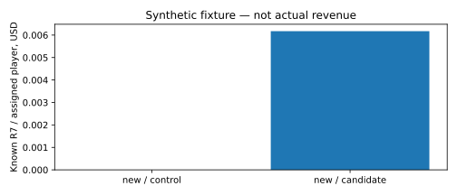

# SDK revenue comparison

synthetic technical fixture

All assigned mature players including zero revenue; immature windows reported separately. Manual/test excluded.

| Cohort | Arm | Assigned | Mature | Known R7/player USD | Unknown impressions | D1 | D7 |
|---|---|---:|---:|---:|---:|---:|---:|
| new | control | 2 | 2 | 0 | 0 | 0/2 | 1/2 |
| new | candidate | 2 | 2 | 0.0061728394506172835 | 1 | 1/2 | 0/2 |
| existing | control | 0 | 0 | None | 0 | 0/0 | 0/0 |
| existing | candidate | 0 | 0 | None | 0 | 0/0 | 0/0 |

Coverage concerns observed diagnostic impressions only; absent callbacks/export rows are not proven absent impressions. R7 is neither LTV, profit nor settled payout.

Uncertainty, funnel and revive quality: summary.json. No automatic winner.
